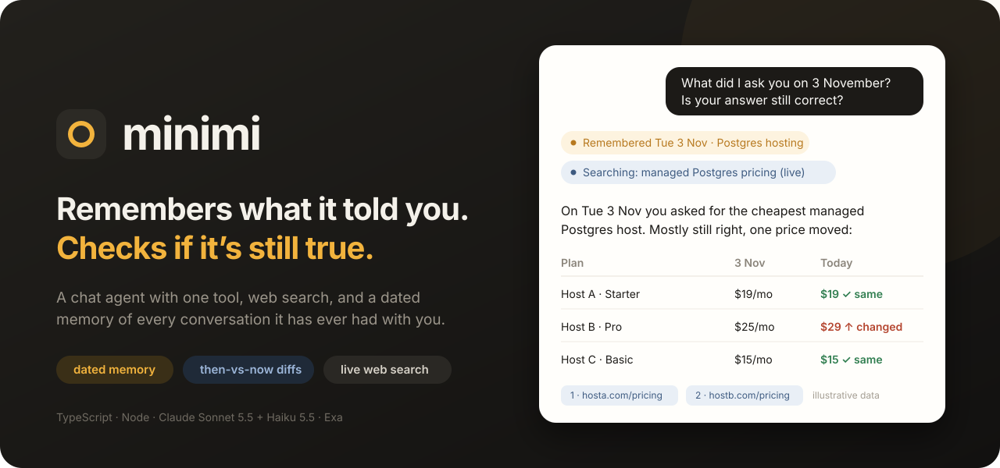
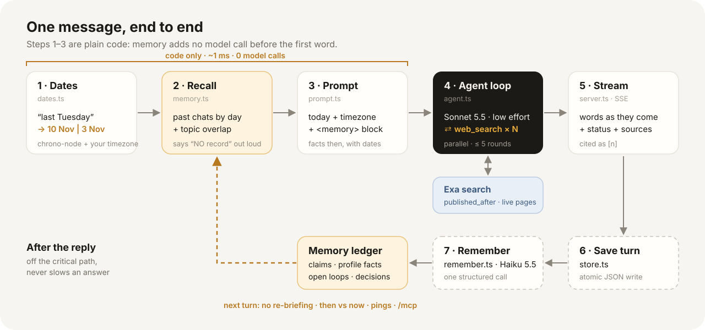
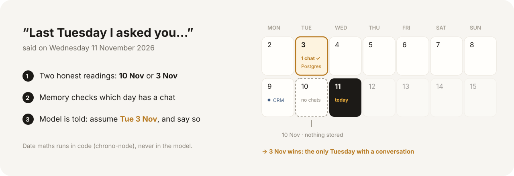
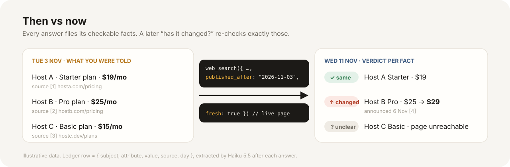
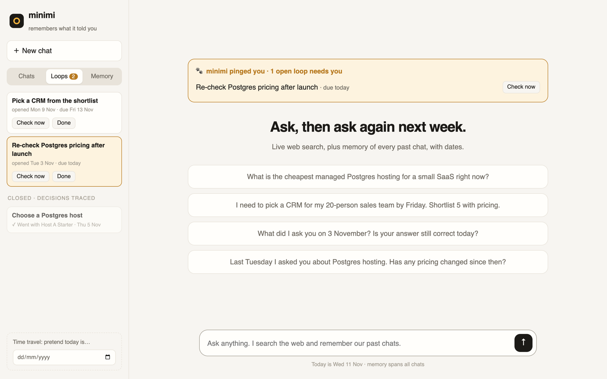
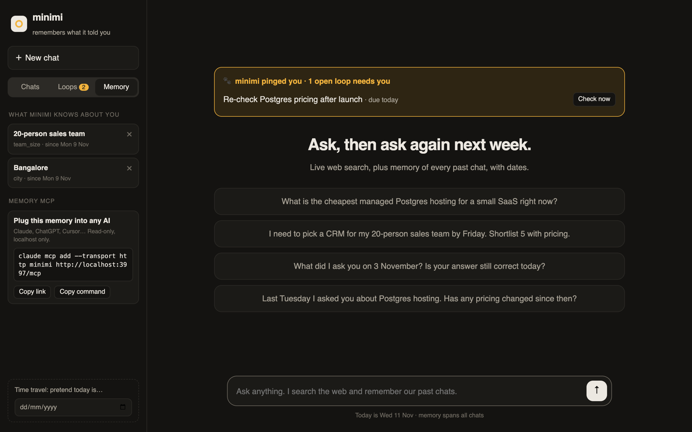

<b>Ask today. Come back next week. Ask “has anything changed?”</b> A chat agent with web search, a dated memory of every conversation, and open loops it pings you about.

---

## ⚡ Run it

- `cp .env.example .env` and add two keys
  - `ANTHROPIC_API_KEY`: answers and background memory
  - `EXA_API_KEY`: the `web_search` tool
- `npm install && npm run dev` then open **http://localhost:3000**
- Try memory without waiting a week
  - Set **Time travel** (sidebar) to 3 Nov, ask about Postgres hosting
  - Clear it, ask *“What did I ask you on 3 November? Still correct?”*
- Plug the memory into Claude: `claude mcp add --transport http minimi http://localhost:3000/mcp`

## 🎯 The insight

- Every example in the brief is about **time**, not search
  - *“What did I ask you on 3 November?”* needs memory across chats, with dates
  - *“Last Tuesday…”* needs date maths that's right: 10 Nov or 3 Nov?
  - *“Changed since?”* needs what was **said** then, to compare with now
- So memory is the core, and search is the tool

## 🧭 How one message flows

- **Before the first word**: code only, 0 model calls
  - dates resolved by `chrono-node` in your timezone
  - memory recalled by day + topic, injected as `<memory>`
- **One agent loop**: Sonnet 5.5, low effort, parallel `web_search`
- **After the reply**: one Haiku 5.5 call files facts, profile and open loops

## 📅 “Last Tuesday” is ambiguous, so it's kept ambiguous

- Both readings kept, memory picks the day that has a chat
- Model is told which day it assumed, and says so
- No chat on that day: the prompt says **NO record**, so it never invents one

## 🔁 Then vs now

- Each answer stores `{subject, attribute, value, source, day}`
- “Changed since?” = old facts + `published_after` + live pricing pages
- Verdict per item: same / changed / couldn't verify

## 🐾 Built in minimi's spirit

 

- **Open loops**, after [“AI cat that closes your open loops”][v-loops]
  - “Pick a CRM by Friday” becomes a loop with a due date
  - A later turn closes it and records the decision: *“✓ went with HubSpot”*
- **Pings at the right moment**, after the homepage's *“AI that pings you at the right moment”*
  - Due or overdue loops appear on their own when you open the app
  - The tab title shows the count; **Check now** runs a fresh search
- **No re-briefing**, after [“AI cat that knows you really well”][v-knows]
  - “20-person sales team” is remembered once and used for later answers
- **Memory MCP**, after minimi's *“digital pendrive for all your memories”*
  - `/mcp`: `recall_memory`, `open_loops`, `about_user`
  - Read-only, stateless, rejects requests with a forged Host header
- **Own your memory**, after *“Your data remains yours only”*
  - See every fact, forget any with ×
  - Server listens on `127.0.0.1` only
- *Screenshots use demo data.*

## ✅ Built to be trusted

- Every searched fact cites `[n]`, shown as a source card with its date
- UI shows the agent's steps: memory chips, search chips, time to first words
- Search failures go back to the model; refusals fall back server-side
- Memory file is written atomically and never overwritten if unreadable

## 🧪 Proof

- `npm test`: 15 unit tests, dates + recall + loops, no keys needed
- `npm run eval`: 9 dataset-style scenarios, Claude-judged, with latency
  - setup turns run on simulated past days, so memory is real agent output
  - results in [`eval/results.md`](eval/results.md)

## 🗂 Code map

- [`src/chat.ts`](src/chat.ts): one turn, no HTTP inside
- [`src/dates.ts`](src/dates.ts): date phrases to day ranges
- [`src/memory.ts`](src/memory.ts): recall + `<memory>` block
- [`src/agent.ts`](src/agent.ts): streaming tool loop
- [`src/search.ts`](src/search.ts): Exa-backed `web_search`
- [`src/remember.ts`](src/remember.ts): facts, profile, open loops
- [`src/mcp.ts`](src/mcp.ts): Memory MCP server
- [`src/store.ts`](src/store.ts): JSON store, atomic writes
- [`src/server.ts`](src/server.ts) + [`public/index.html`](public/index.html): Hono, SSE, UI

## 📄 Design

- Decisions, trade-offs, rejected options, next week: [**DESIGN.md**](DESIGN.md)

## 📚 References: where the minimi ideas came from

- [projectminimi.com](https://www.projectminimi.com/): open loops, pings, Memory MCP, “Own your memory”
- [projectminimi.com/about](https://www.projectminimi.com/about): *“We believe AI should come to you on its own.”*
- YouTube [@projectminimi](https://www.youtube.com/@projectminimi)
  - [AI cat that closes your open loops][v-loops] (2 Aug 2026)
  - [AI cat that knows you really well][v-knows] (2 Aug 2026)
  - [The Ultimate Company Brain](https://www.youtube.com/watch?v=DOLqiAeP1Uw) (16 Jun 2026)
  - [Your Ambient Memory Built by Two Architects](https://www.youtube.com/watch?v=TZdPY4uXONo) (24 Jun 2026)
- [BetaList: “Private AI that helps before you ask.”](https://betalist.com/startups/minimi)
- [Razorpay Rize: “Architects Who Learned to Build in Code”](https://rizevault.razorpay.com/p/architects-who-learned-to-build-in)
- Product Hunt: minimi 2.0, *“AI cat that closes your open loops”* (Sep 2026)
- Team on X: [@Ozacle23](https://x.com/Ozacle23)

[v-loops]: https://www.youtube.com/watch?v=bgiqGUo-thQ
[v-knows]: https://www.youtube.com/watch?v=uV2dpz1ZyTo
